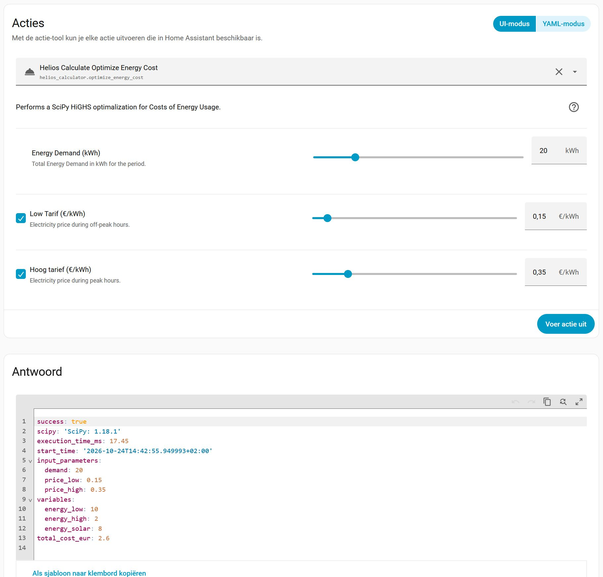

# Helios Calculator - Documentation

## Why use a Linear Programming Model
See [Why use Linear Programming?](WHY.md#why-use-lp-en) or [Waarom Lineair Programmeren gebruiken?](WHY.md#waarom-lp-gebruiken-nl)

## Description
The Helios Calculator demonstrates how a LP model can be used in Home Assistant with a simple Optimization Model.

### Input
It exposes a service that calculates an optimum for a very simple model with 3 input parameters:
- **D  = Energy Demand (kWh):** How much energy do we need in total
- **LT = Low Tarif (€/kWh):** What is the low tarif for electricity (Default: 0.15 €/kWh)
- **HT = High Tarif (€/kWh):** What is the high tarif for electricity (Default: 0.35 €/kWh)

### Model
The Model has 3 variables that need to be optimized using LP:
- **x0 is Low Tarif Energy  (kWh):** How much Energy do we use from the Grid at the low tarif (Maximum is 10kWh)
- **x1 is High Tarif Energy (kWh):** How much Energy do we use from the Grid at the high tarif (No Limit)
- **x2 is Sun Energy (kWh):** How much Energy do we use from the Grid at the high tarif 
  (Maximum is 8 kWh but with a small fixed charge of ST = 0.05 €/kWh)

### The Rules
 The **Energy** must be balanced: D = x0 + x1 + x2
 The **total** costs are: LT * x0 + HT * x1 + ST * x2
 We want to calculate the values for x0, x1 and x2 where the total cost are at the minimum.

### Output
The output of the Service will be the values of the variables x0, x1 and x3 and the total cost for these values.

### Remark
The results of this model can of course be easily calculated by hand.
 The implementation is only meant to test the LP function with a Custom Component in Home Assistant.
 In addition it will serve as a starting point to migrate the pyscript implementation of an Energy Optimization Model to a Custom Component Implementation.

## How to Use
From the Home Assistant Menu - Settings - Tools - Actions
 Search for **"Calculate Optimized Schedule"** or **"helios.calculator.optimize_schedule"**.
 Specify at least the Energy Demand and press "Perform Action".
 The response from the service will be displayed in the "Answer" section.

